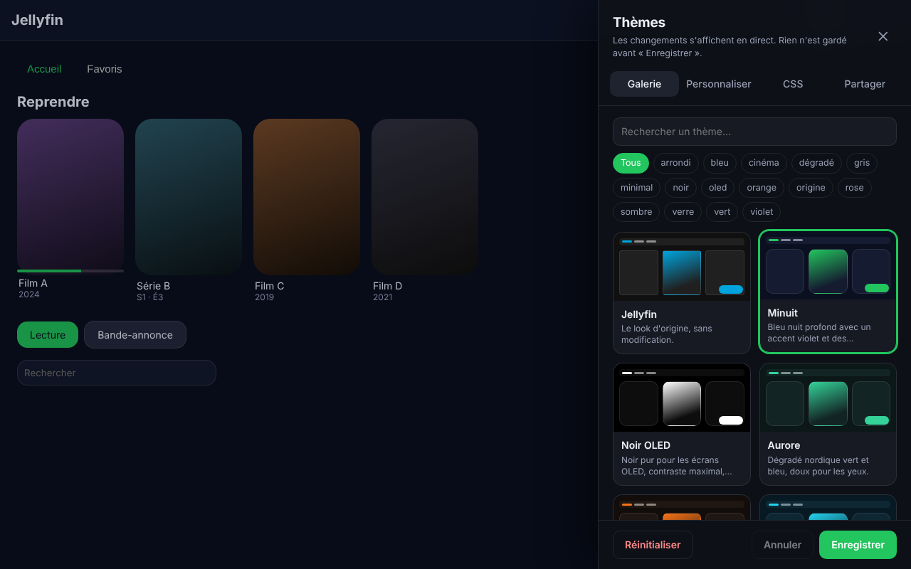
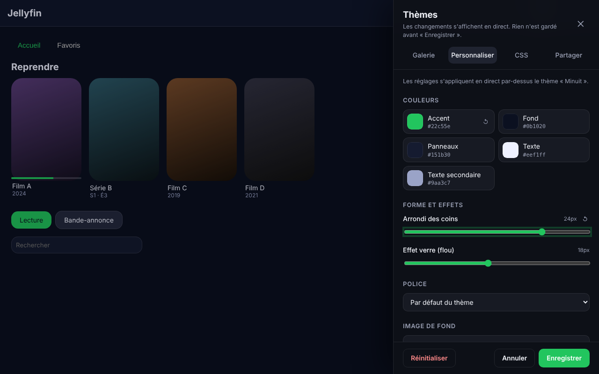
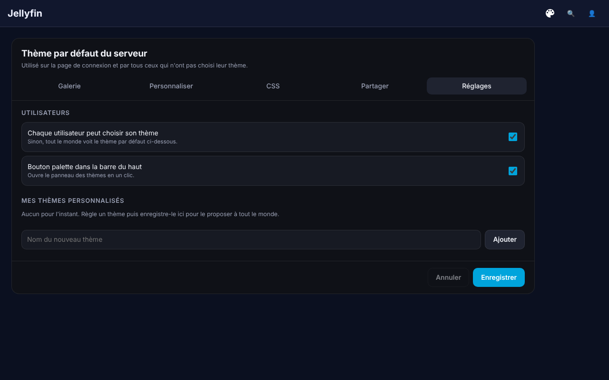
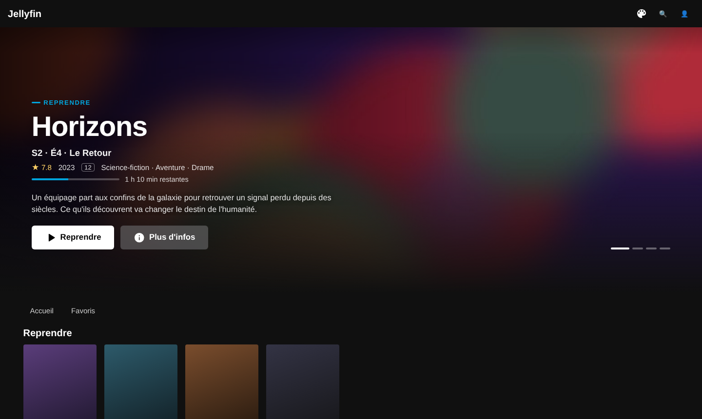

# Theme Studio pour Jellyfin

Des thèmes modernes pour Jellyfin, avec **aperçu en direct**, **un thème par utilisateur** et un **éditeur visuel**.
Pensé comme un successeur plus pratique de Skin Manager.



## Installation (une seule étape)

1. Dans Jellyfin : **Tableau de bord → Extensions → Dépôts → +**, puis colle cette adresse :
   ```
   https://raw.githubusercontent.com/JohannDeon/jellyfin-plugin-theme-studio/main/manifest.json
   ```
2. Dans le **Catalogue**, installe **Theme Studio**, puis redémarre Jellyfin.

C'est tout. Il n'y a aucun fichier à modifier, pas de CSS à coller, et aucun autre plugin à installer.
Un bouton palette apparaît dans la barre du haut de l'interface web.

> Fonctionne avec Jellyfin **10.11** et **12**. Jellyfin installe automatiquement la bonne version.

## Ce que ça fait

| | Skin Manager | Theme Studio |
|---|---|---|
| Aperçu | Captures d'écran | **En direct**, sur ta vraie bibliothèque |
| Qui choisit le thème | L'admin, pour tout le monde | L'admin fixe le thème par défaut, **chaque utilisateur peut choisir le sien** |
| Ton CSS personnalisé | Écrasé à chaque changement | **Conservé** (CSS admin + CSS perso par utilisateur) |
| Personnalisation | Options propres à chaque skin | **Éditeur unique** : couleurs, arrondis, effet verre, police, image de fond |
| Thèmes chargés depuis Internet | Oui (problèmes de CSP derrière un reverse proxy) | **Non**, tout est servi par ton serveur |
| Partage | Non | **Import / export** d'un thème en un fichier |
| Page de connexion | Thème global | Thème par défaut du serveur |

### Pour chaque utilisateur
- Clique sur l'icône **palette** en haut à droite.
- **Galerie** : choisis un thème, l'interface change immédiatement.
- **Personnaliser** : couleur d'accent, fond, panneaux, texte, arrondi des coins, effet verre, police et image de fond.
- **CSS** : ton CSS perso, visible uniquement pour toi.
- **Partager** : exporte ou importe un thème.
- **Enregistrer** garde ton choix sur le serveur, il te suit donc sur tous tes appareils. **Annuler** remet l'ancien thème.



### Pour l'administrateur
**Tableau de bord → Theme Studio** (ou **Extensions → Theme Studio**) :
- thème par défaut du serveur (page de connexion comprise) avec le même éditeur en direct ;
- autoriser ou non les utilisateurs à choisir leur thème, afficher ou non le bouton palette ;
- créer des thèmes personnalisés et les proposer à tout le monde, importer des thèmes ;
- un diagnostic indique si l'injection dans l'interface web fonctionne.



### Grande bannière d'accueil
En haut de la page d'accueil, une grande image plein écran fait défiler les films et séries **à reprendre** puis les **nouveautés** :
logo ou titre, note, année, genres, résumé, progression, et les boutons **Lecture / Reprendre** et **Plus d'infos**.
Elle défile toute seule (pause au survol), avec des flèches et des points pour naviguer.

- **Bande-annonce** : après quelques secondes, la bande-annonce YouTube remplace l'image, sans le son (bouton pour l'activer). Désactivée sur mobile, en mode économie de données et si les animations sont réduites.
- **Ma liste** : le bouton ＋ ajoute le titre à tes favoris (la série entière pour un épisode).
- Admin : **Réglages → Page d'accueil** pour l'activer ou non et choisir son contenu (à reprendre + nouveautés, seulement l'un ou l'autre).
- Utilisateur : **Personnaliser → Page d'accueil** pour l'afficher ou la masquer pour soi.



## Mise en page streaming
Activée par défaut (admin : **Réglages → Mise en page**).
- **Ordinateur** : barre de navigation à gauche qui remplace la barre du haut. Repliée, elle ne montre que les icônes ; elle s'ouvre au survol de la souris (recherche, accueil, Ma liste, médiathèques, paramètres). Seules les icônes de droite de Jellyfin (profil, diffusion, recherche) restent en haut. L'accueil affiche une grande carte « Reprendre » à côté des titres suivants en affiches hautes, et les affiches portent leur titre directement sur l'image.
- **Fiches films, séries et collections** : image plein écran, logo, année, saisons, classification, note, genres, résumé, gros bouton Lecture (« Reprendre S2 É3 » pour une série), Ma liste, bande-annonce et infos. Pour une série, des onglets de saisons et une rangée d'épisodes en vignettes : un clic lance l'épisode.
- **TV (LG webOS, Samsung)** : la barre de gauche remplace aussi celle du haut ; flèche gauche au bord de la page pour l'ouvrir, haut/bas pour choisir, droite pour revenir. Le navigateur de ces TV est ancien. Le thème y reste simple (pas de flou, panneaux opaques), avec un contour bien visible sur l'élément sélectionné à la télécommande. L'application native **Jellyfin Android TV** n'affiche pas l'interface web : aucune extension de thème ne peut la modifier.

## Thèmes inclus

Jellyfin (d'origine), Cinéma, Verre, Cristal, Galaxie, Minuit, Noir OLED, Aurore, Braise, Océan, Rosé, Ardoise.

Dès qu'un thème est actif, l'interface prend aussi un style plus moderne : cartes qui se soulèvent au survol, titres de rangées plus marqués, fiches avec affiche en relief, boutons ronds et genres en pastilles.

## Compatibilité
- **TV LG / Samsung** : compatible (version allégée, voir plus haut).
- **Genre Collections** : compatible. La bannière reste tout en haut, et les rangées de Genre Collections prennent automatiquement le style du thème.

## Comment ça marche

- Au démarrage, le plugin ajoute un petit middleware qui insère `ThemeStudio/default.css` et `ThemeStudio/client.js`
  dans la page `index.html` de Jellyfin Web **au moment où elle est envoyée**. Rien n'est écrit sur le disque,
  donc ça fonctionne aussi avec Docker et les installations en lecture seule. Le chemin de base (`/jellyfin`, etc.) est géré.
- Un thème est un ensemble de variables (`--ts-accent`, `--ts-bg`, `--ts-radius`…) appliquées à l'interface par
  `engine.css`, plus du CSS optionnel.
- Les choix des utilisateurs sont stockés dans `plugins/configurations/ThemeStudio/users/<id>.json` (ils survivent aux mises à jour du plugin).
- Les applis qui utilisent l'interface web du serveur (navigateur, Jellyfin Media Player, appli Android) ont le thème.
  Les applis natives (Android TV, Swiftfin, Roku…) ne l'affichent pas.

### API
| Méthode | Route | Accès |
|---|---|---|
| GET | `/ThemeStudio/client.js`, `/ThemeStudio/engine.css`, `/ThemeStudio/default.css` | public |
| GET | `/ThemeStudio/Bootstrap` | utilisateur connecté |
| PUT / DELETE | `/ThemeStudio/Me` | utilisateur connecté |
| GET / PUT | `/ThemeStudio/Admin` | administrateur |

## Format d'un thème exporté

```json
{
  "format": "theme-studio",
  "version": 1,
  "name": "Mon thème",
  "tokens": {
    "accent": "#8b5cf6", "background": "#0b1020", "surface": "#151b30",
    "text": "#eef1ff", "textSecondary": "#9aa3c7",
    "radius": 14, "blur": 18, "font": "system-ui",
    "backgroundImage": "https://…", "backgroundDim": 70
  },
  "css": "/* optionnel */"
}
```

## Développement

```sh
dotnet test                     # tests (SDK .NET 10, compile aussi la version .NET 9 pour Jellyfin 10.11)
dotnet publish src/Jellyfin.Plugin.ThemeStudio -c Release -o out
```
Ajoute `-f net9.0` (Jellyfin 10.11) ou `-f net10.0` (Jellyfin 12), puis copie `out/Jellyfin.Plugin.ThemeStudio.dll` dans `plugins/ThemeStudio/` puis redémarre Jellyfin.

### Publier une version
Augmente `<PluginVersion>` dans `src/Jellyfin.Plugin.ThemeStudio/Jellyfin.Plugin.ThemeStudio.csproj` et fusionne dans `main`.
Le workflow **Release** compile le plugin pour Jellyfin 10.11 et 12, crée la release GitHub et met à jour `manifest.json` automatiquement.
